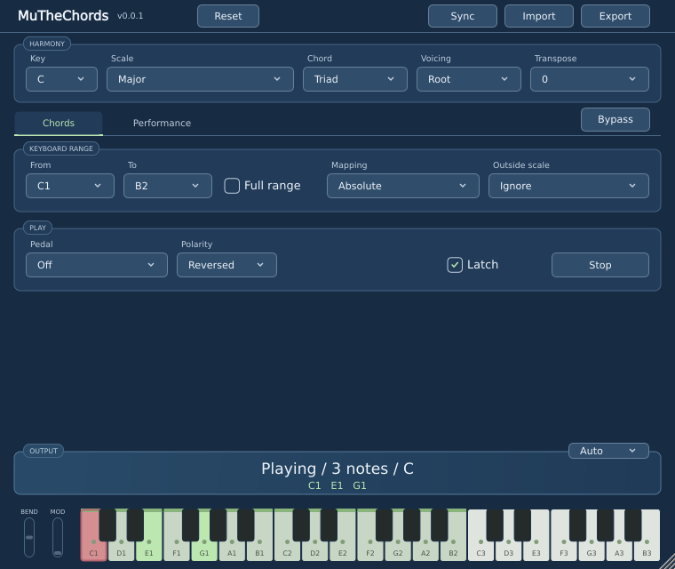

# MuTheChords

[](https://github.com/tomasmark79/MuTheChords/actions/workflows/quality.yml)
[](https://github.com/tomasmark79/MuTheChords/actions/workflows/native.yml)
[](https://github.com/tomasmark79/MuTheChords/actions/workflows/static-analysis.yml)
[](https://github.com/tomasmark79/MuTheChords/actions/workflows/sanitizers.yml)
[](https://github.com/tomasmark79/MuTheChords/actions/workflows/cross-builds.yml)
[](https://github.com/tomasmark79/MuTheChords/actions/workflows/docs.yml)

## Music Theory Chords — C++20 Library, CLI & VST3/CLAP Audio Plugin

**MuTheChords** (*Music Theory Chords*) is a multiplatform MIDI chord generator, music-theory engine, and rhythmic performance processor. Built on the [NixonCpp](README_NixonCpp.md) architecture with **Meson**, **CMake/JUCE**, and reproducible **Nix** environments, it provides:

- **`MuTheChordsLib`** — a self-contained, JUCE-free C++20 music-theory and real-time MIDI engine (`namespace muthechords`), cross-compilable for **Linux x86_64**, **Linux ARM64**, and **Windows**.
- **`MuTheChords` Plugin (VST3 & CLAP)** — a sample-accurate MIDI chord and rhythmic performance instrument plugin for Bitwig Studio and modern DAWs on Linux and Windows.
- **`MuTheChords` CLI Application** — a command-line inspection and preview utility powered by `MuTheChordsLib` and `UtilsFactory`.

<p align="center">
  
</p>

## Online Documentation & Web Preview

- 📖 **[API Documentation (Doxygen)](https://tomasmark79.github.io/MuTheChords/html/index.html)** — complete C++20 class, namespace, and architecture reference published via GitHub Pages.
- 🌐 **[Interactive WebAssembly Build](https://tomasmark79.github.io/MuTheChords/)** — run the standalone `MuTheChords` runtime directly in your browser.

---

## Feature Overview

### 1. Harmony & Voicing (`Chords` Mode)

| Feature | Description |
| --- | --- |
| **Keys & Scales** | **12 Keys** (`C`–`B`) and **44 Scales** including Major, Dorian, Phrygian, Lydian, Mixolydian, Minor, Locrian, Harmonic/Melodic Minor, Harmonic Major, Pentatonics, Blues, Bebop, Hungarian, Persian, Hirajoshi, Whole Tone, Diminished, Altered, Chromatic, and Iwato. |
| **Chord Types** | Stacks scale degrees into **Thirds**, **Triads**, **7th**, **9th**, **11th**, and **13th** chords. |
| **15 Voicing Modes** | **Inversions**: Root, 1st–6th inversion.<br>**Spread**: *Bass down*, *Top up*, *Open*, *Wide*, *Drop 2*.<br>**Octaves**: *Bass octave* (adds root below), *Octave up*, *Octave down*. |
| **Transposition** | Shifts generated chord output by **-36 to +36 semitones** without affecting solo pass-through notes. |
| **Chord Naming** | Context-aware chord symbol detection (e.g., `Dm7/F`, `Cmaj11(#11)`) with selectable **Auto**, **Flats (`♭`)**, or **Sharps (`♯`)** enharmonic spelling. |

### 2. Keyboard Range, Mapping & Controllers

| Feature | Description |
| --- | --- |
| **Input Range** | Configurable `From`/`To` MIDI range (defaults to `C1`–`B2`, MIDI `36`–`59` in Bitwig octave naming) or **Full range**. Notes outside the range pass through polyphonically (`+ solo`). |
| **Key Mapping** | **Absolute**: scale notes trigger chords.<br>**Relative**: white keys (`C`–`B`) trigger successive scale degrees (`C` = tonic). |
| **Outside-Scale Policy** | Choose **Ignore**, **Pass note**, **Snap down**, **Snap up**, or **Nearest** for non-scale input keys. |
| **Sustain Pedal (CC64)** | Selectable **Normal** (`64–127`) or **Reversed** (`0–63`) polarity.<br>Modes: **Off**, **Hold** (sustains chord until pedal release), or **Chord Switch** (selects `Alt Chord` while pedal is held). |
| **Latch & Stop** | **Latch** holds the triggered chord after key release (re-triggering the same key toggles it off). **Stop** and **Bypass** cleanly release all active voices. |
| **MIDI Transparency** | Retains input velocity, MIDI channels (`1`–`16`), 14-bit pitch bend, mod wheel (`CC1`), and aftertouch, with live **BEND** and **MOD** indicators. |

### 3. Rhythmic Pattern Engine (`Performance` Mode)

| Feature | Description |
| --- | --- |
| **Pattern Adaptation** | Adapts multi-voice rhythmic and melodic phrases dynamically to the active chord harmony and scale. |
| **Transport & Tempo Sync** | **DAW Sync** aligns pattern starts to the host beat; when stopped, held keys or clicking the **Pattern Graph** (`Preview`) play immediately at the last known host tempo. |
| **Timing & Feel** | **Rate** multipliers from `×0.25` to `×2` combined with **Straight** or **Triplet** division. |
| **Voices & Passing Tones** | **Voices**: *Auto*, *All*, or *Pattern*.<br>**Passing notes**: *Off* (chord tones only) or *Scale* (diatonic passing steps). |
| **Transitions & Looping** | **Chord change**: *Continue*, *Restart*, or *Next beat*.<br>**Note transition**: *Cut*, *Retain common*, or *Let ring*.<br>**Playback**: *Held*, *One pass*, or *Continuous*, with draggable bar-loop handles on the interactive graph. |

### 4. Multi-Instance Workflow & Host Integration

- **Shared Harmony (`Sync`)**: Peer-to-peer synchronization of `Key` and `Scale` across multiple plugin instances (`All instances equal`), even across separate VST3/CLAP host processes.
- **External Profiles (`.chordprofile`)**: Atomic JSON Import/Export (`MuTheChordsProfile` v2) for storing complete Harmony, Performance, and per-pattern loop regions independently of DAW projects.
- **DAW Automation & Remote Controls**: All 32 parameters are automatable and support VST3 parameter-under-mouse identification for Bitwig Studio Remote Controls.

---

## Quick Start

### 1. Core Library, CLI & Unit Tests (Meson + Nix)

Have **Git** and **Nix with flakes enabled** installed. The Nix flake devShell provides GCC/Clang, Meson, CMake, Ninja, GoogleTest, and all library dependencies.

```bash
git clone https://github.com/tomasmark79/MuTheChords.git
cd MuTheChords

# Build release library + CLI application
make build

# Run the GoogleTest suite (9 test suites covering engine, naming, mailbox, sync, patterns & utils)
make test

# Run clang-tidy static analysis and clang-format verification
make check
make format-check

# Run the CLI application (list scales and preview a chord on MIDI note 62)
./build/builddir-release/MuTheChords --scales -n 62
```

### 2. Audio Plugin — VST3 & CLAP (CMake + JUCE)

Building the VST3 and CLAP plugin targets uses `JUCE` and `clap-juce-extensions` under `third_party/` (gitignored):

```bash
# Build Linux VST3 & CLAP plugins and run all 7 plugin/host smoke tests
make plugin

# Cross-compile Windows VST3 & CLAP plugins (Clang/LLVM MSVC target + Windows SDK)
make plugin-windows
```

Built plugin bundles are placed in `dist/linux/` and `dist/windows/` (`MuTheChords.vst3` and `MuTheChords.clap`).
Private external pattern libraries (`*.patterns.json`) are excluded from the repository via `.gitignore`; when present locally in `dist/<platform>/MuTheChords.patterns.json` (or specified via `MUTHECHORDS_PATTERN_LIBRARY`), they are loaded automatically.

### 3. Cross-Compilation (Linux & Windows)

```bash
make cross-aarch64   # Build library & CLI for Linux ARM64
make cross-windows   # Build library & CLI for Windows (MinGW x86_64)
```

---

## Project Structure

| Location | Purpose |
| --- | --- |
| [include/MuTheChordsLib/](include/MuTheChordsLib/) | Public C++20 headers (`ChordEngine`, `PerformanceEngine`, `ChordNames`, `Scales`, `Voicing`, `PatternLibrary`, `HarmonySync`, `DisplayMailbox`) |
| [src/lib/](src/lib/) | `MuTheChordsLib` implementation and NixonCpp `Utils` services (`ILogger`, `IFileReader`, `IJsonSerializer`, `IAssetManager`, `IPlatformInfo`) |
| [src/plugin/](src/plugin/) | JUCE `MuTheChordsProcessor`, `MuTheChordsEditor`, `ProfileState`, and `Vst3MidiOutputMonitor` |
| [src/app/](src/app/) | Standalone CLI entry point ([Application.cpp](src/app/Application.cpp)) |
| [tests/](tests/) | GoogleTest unit tests (`*Test.cpp`) and JUCE/VST3/CLAP integration & smoke tests |
| [meson.build](meson.build) | Primary Meson build definition for `MuTheChordsLib`, CLI app, and GoogleTest suite |
| [CMakeLists.txt](CMakeLists.txt) | CMake configuration for VST3 & CLAP plugin targets and plugin CTest suite |
| [nix/](nix/) | Reproducible Nix flake development shells and cross-compilation toolchains |

## Architecture

The project follows the **NixonCpp** design: real-time MIDI processing (`ChordEngine`, `PerformanceEngine`, `DisplayMailbox`) is strictly lock-free and allocation-free on the audio thread, while non-realtime services (`PatternLibrary`, `HarmonySync`, CLI context) use `UtilsFactory` abstractions for filesystem, JSON serialization, logging, and platform discovery.

[](docs/architecture.svg)

- [API Documentation (Doxygen on GitHub Pages)](https://tomasmark79.github.io/MuTheChords/html/index.html)
- [Original NixonCpp Template README](README_NixonCpp.md)
- [Build targets and packaging](docs/build-targets.md)
- [Debugging](docs/debugging.md)
- [Development tools](docs/development-tools.md)

## Support

If MuTheChords helps with your music or software projects, you can support its development:

[](https://paypal.me/TomasMark)

## License

[MIT](LICENSE) (Note: JUCE plugin targets depend on JUCE and `clap-juce-extensions` under their respective licenses in `third_party/`).
