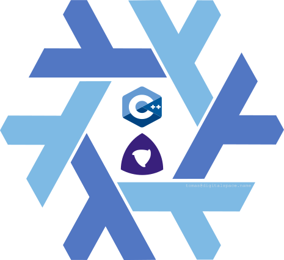

# MuTheChords

[](https://github.com/tomasmark79/MuTheChords/actions/workflows/quality.yml)
[](https://github.com/tomasmark79/MuTheChords/actions/workflows/native.yml)
[](https://github.com/tomasmark79/MuTheChords/actions/workflows/static-analysis.yml)
[](https://github.com/tomasmark79/MuTheChords/actions/workflows/sanitizers.yml)
[](https://github.com/tomasmark79/MuTheChords/actions/workflows/cross-builds.yml)
[](https://github.com/tomasmark79/MuTheChords/actions/workflows/docs.yml)

<p align="center">
  
</p>

## Music Theory Chords — C++20 Library, CLI & VST3/CLAP Audio Plugin

**MuTheChords** (*Music Theory Chords*) is a multiplatform MIDI chord generator, music-theory engine, and rhythmic performance processor. Built on the [NixonCpp](README_NixonCpp.md) architecture with **Meson**, **CMake/JUCE**, and reproducible **Nix** environments, it provides:

- **`MuTheChordsLib`** — a self-contained, JUCE-free C++20 music-theory and real-time MIDI engine (`namespace muthechords`), cross-compilable for **Linux x86_64**, **Linux ARM64**, **Windows**, and **WebAssembly**.
- **`MuTheChords` Plugin (VST3 & CLAP)** — a sample-accurate MIDI chord and rhythmic performance instrument plugin for Bitwig Studio and modern DAWs on Linux and Windows.
- **`MuTheChords` CLI / WebAssembly App** — a command-line and browser-ready application powered by `MuTheChordsLib` and `UtilsFactory`.

<p align="center">
  
</p>

## Musical Capabilities

### Harmony & Voicing (`Chords` Mode)
- **44 Musical Scales & 12 Keys**: Covers Major, Dorian, Phrygian, Lydian, Mixolydian, Minor, Locrian, Harmonic & Melodic Minor, Harmonic Major, Pentatonics, Blues, Bebop, Hungarian, Persian, Hirajoshi, Whole Tone, Diminished, Altered, Chromatic, Iwato, and more.
- **Chord Stacking & 15 Voicings**: Generates Thirds, Triads, 7th, 9th, 11th, and 13th chords by stacking scale degrees. Supports Root position, 1st–6th inversions, spread voicings (*Bass down*, *Top up*, *Open*, *Wide*, *Drop 2*), *Bass octave* doubling, and octave shifts, plus `-36` to `+36` semitone transposition.
- **Input Range & Mapping**: Configurable `From`/`To` MIDI range (default `C1`–`B2` in Bitwig notation, `MIDI 36`–`59`) or `Full range`. Notes outside the range pass through polyphonically as solo notes.
  - **Absolute** mapping triggers chords from scale notes.
  - **Relative** mapping assigns successive scale degrees to white keys (`C` selects the tonic).
  - **Outside scale** policy: *Ignore*, *Pass note*, *Snap down*, *Snap up*, or *Nearest*.
- **Sustain Pedal (CC64) & Latch**: Configurable pedal polarity (*Normal* or *Reversed*) with *Off*, *Hold* (retains chord until pedal release), and *Chord Switch* (temporarily selects `Alt Chord` on next trigger). *Latch* holds chords hands-free until re-triggered or stopped.
- **Context-Aware Chord Naming**: Lock-free `DisplayMailbox` transfers sounding chord state from the audio thread to the UI without allocations. Displays chord symbols (e.g., `Dm7/F`, `Cmaj11(#11)`) and note lists with selectable *Auto*, *Flats* (`♭`), or *Sharps* (`♯`) enharmonic spelling.
- **Transparent MIDI Routing**: Preserves velocity, MIDI channels (`1`–`16`), 14-bit pitch bend, mod wheel (`CC1`), and aftertouch with live `BEND` and `MOD` input indicators.

### Rhythmic Pattern Engine (`Performance` Mode)
- **Adaptive Phrase & Rhythm Playback**: Drives external rhythmic/melodic patterns mapped dynamically onto the currently triggered harmony and scale.
- **Transport & Tempo Sync**: Sample-accurate scheduling synchronized with the DAW playhead (`DAW Sync` on/off), plus immediate held-key playback and hands-free graph audition (`Preview`) when the DAW transport is stopped.
- **Playback & Transitions**:
  - **Rate & Division**: `×0.25` to `×2` speed multipliers with *Straight* or *Triplet* feel.
  - **Voices & Passing Notes**: *Auto*, *All*, or *Pattern* voice allocation; optional diatonic scale passing tones.
  - **Chord Change & Note Transition**: *Continue*, *Restart*, or *Next beat* harmony changes; *Cut*, *Retain common*, or *Let ring* voice transitions.
  - **Playback Modes & Bar Looping**: *Held*, *One pass*, or *Continuous* playback with interactive bar-loop handles on the pattern graph.

### Cross-Instance Harmony Sync & External Profiles
- **Shared Harmony (`Sync`)**: Equal peer-to-peer synchronization of `Key` and `Scale` across multiple plugin instances (even across separate VST3/CLAP host processes) via OS-level file locking.
- **Profile Import / Export (`.chordprofile`)**: Atomic JSON profile serialization (`MuTheChordsProfile` v2) for saving and sharing complete plugin configurations independently of DAW presets.
- **Host Automation**: Exposes all 32 automatable parameters to the host (including VST3 parameter-under-mouse identification for Bitwig Remote Controls).

## Quick Start

### 1. Core Library, CLI & Unit Tests (Meson + Nix)

Have **Git** and **Nix with flakes enabled** installed. The Nix flake devShell provides GCC/Clang, Meson, CMake, Ninja, GoogleTest, and all library dependencies.

```bash
git clone https://github.com/tomasmark79/MuTheChords.git
cd MuTheChords

# Build release library + CLI application
make build

# Run the GoogleTest suite (9 test suites covering engine, naming, mailbox, sync, patterns & utils)
make test

# Run the CLI application (list scales and preview a chord on MIDI note 62)
./build/builddir-release/MuTheChords --scales -n 62
```

### 2. Audio Plugin — VST3 & CLAP (CMake + JUCE)

Building the VST3 and CLAP plugin targets requires `JUCE` and `clap-juce-extensions` under `third_party/` (gitignored):

```bash
# Build Linux VST3 & CLAP plugins and run all 7 plugin/host smoke tests
make plugin

# Cross-compile Windows VST3 & CLAP plugins (Clang/LLVM MSVC target + Windows SDK)
make plugin-windows
```

Built plugin bundles are placed in `dist/linux/` and `dist/windows/` (`MuTheChords.vst3` and `MuTheChords.clap`).
Private external pattern libraries (`*.patterns.json`) are intentionally excluded from the public repository via `.gitignore`; when present locally in `dist/<platform>/MuTheChords.patterns.json` (or pointed to by `MUTHECHORDS_PATTERN_LIBRARY`), they are discovered automatically.

### 3. Cross-Compilation (NixonCpp Targets)

```bash
make cross-aarch64   # Build library & CLI for Linux ARM64
make cross-windows   # Build library & CLI for Windows (MinGW x86_64)
make cross-wasm      # Build library & app for WebAssembly (Emscripten)
make cross-all       # Build all cross-compilation targets
```

## Project Structure

| Location | Purpose |
| --- | --- |
| [include/MuTheChordsLib/](include/MuTheChordsLib/) | Public C++20 headers (`ChordEngine`, `PerformanceEngine`, `ChordNames`, `Scales`, `Voicing`, `PatternLibrary`, `HarmonySync`, `DisplayMailbox`) |
| [src/lib/](src/lib/) | `MuTheChordsLib` implementation and NixonCpp `Utils` services (`ILogger`, `IFileReader`, `IJsonSerializer`, `IAssetManager`, `IPlatformInfo`) |
| [src/plugin/](src/plugin/) | JUCE `MuTheChordsProcessor`, `MuTheChordsEditor`, `ProfileState`, and `Vst3MidiOutputMonitor` |
| [src/app/](src/app/) | Standalone CLI / WebAssembly entry point ([Application.cpp](src/app/Application.cpp)) |
| [tests/](tests/) | GoogleTest unit tests (`*Test.cpp`) and JUCE/VST3/CLAP integration & smoke tests |
| [meson.build](meson.build) | Primary Meson build definition for `MuTheChordsLib`, CLI app, and GoogleTest suite |
| [CMakeLists.txt](CMakeLists.txt) | CMake configuration for VST3 & CLAP plugin targets and plugin CTest suite |
| [nix/](nix/) | Reproducible Nix flake development shells and cross-compilation toolchains |

## Architecture

The project follows the **NixonCpp** design: real-time MIDI processing (`ChordEngine`, `PerformanceEngine`, `DisplayMailbox`) is strictly lock-free and allocation-free, while non-realtime services (`PatternLibrary`, `HarmonySync`, CLI context) use `UtilsFactory` abstractions for filesystem, JSON serialization, logging, and platform discovery.

[](docs/architecture.svg)

- [Original NixonCpp Template README](README_NixonCpp.md)
- [Build targets and packaging](docs/build-targets.md)
- [Debugging](docs/debugging.md)
- [Development tools](docs/development-tools.md)

## Support

If MuTheChords helps with your music or software projects, you can support its development:

[](https://paypal.me/TomasMark)

## License

[MIT](LICENSE) (Note: JUCE plugin targets depend on JUCE and `clap-juce-extensions` under their respective licenses in `third_party/`).
